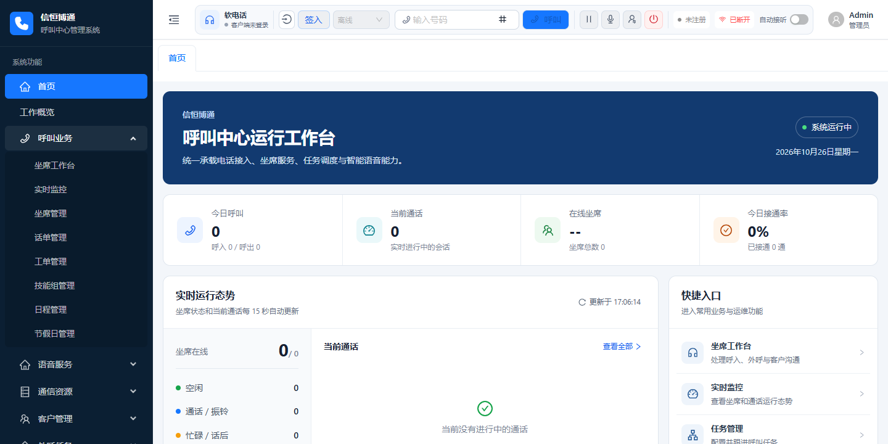
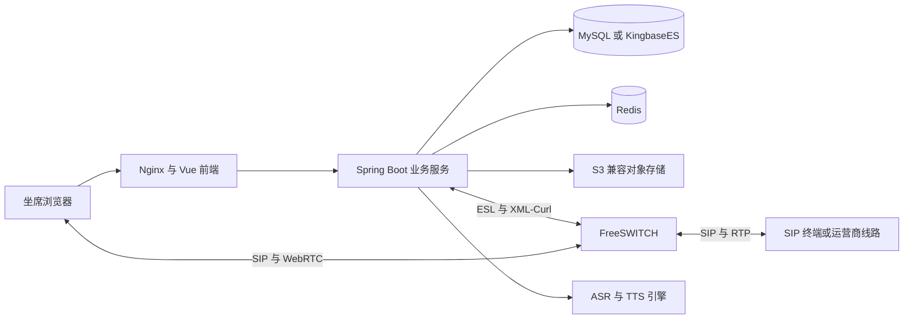

# 信恒博通呼叫中心

**Call Center OSS · 让电话流程连接业务，让语音能力可以自由扩展。**

信恒博通呼叫中心是一个面向企业客户联络场景的开源项目，基于 **Java 17、Spring Boot 3、Vue 3 和 FreeSWITCH** 构建，提供坐席、技能组、IVR、客户、工单与语音服务等功能，支持私有化部署。

我们基于 [OpenCallHub](https://github.com/sxwdmjy/openCallHub) 持续维护和扩展这个项目，重点补充业务流程编排、通话转写、语音引擎适配和部署工具。希望开发者拿到代码后，能够理解一次电话如何流转、业务规则在哪里执行，以及如何接入自己的系统。

## 为什么维护这个项目

在实际项目中，电话接通只是开始。接下来往往还需要查询客户信息、根据业务条件选择服务团队、记录沟通内容，再把需要处理的事项交给后续人员。不同项目的规则又各不相同。

我们希望把这些共性能力沉淀下来：电话控制交给 FreeSWITCH，业务逻辑放在 Java 服务中，流程通过 IVR 编排，识别与合成通过统一接口接入。开发者可以从现有模块开始，逐步扩展成适合自己业务的客服、售后、回访或内部服务台。

## 可以用它做什么

| 能力 | 当前内容 | 可以解决的问题 |
| --- | --- | --- |
| 电话与坐席管理 | 呼入呼出业务、坐席状态、技能组、话单、SIP 软电话接入 | 将电话接待和人员分工放到同一套业务系统中 |
| 可视化 IVR | 流程编辑、条件分支、变量赋值、数据库查询、简单脚本赋值、技能组转接 | 根据服务时间、客户类型和查询结果组织电话流程 |
| 通话转写 | 音频处理、识别会话、临时与最终文本、实时推送、转写记录保存 | 为沟通内容提供可以查阅和继续处理的文字记录 |
| 语音合成 | 文本合成任务、音频文件、缓存与播放对接 | 将欢迎语、服务提示和业务播报接入电话流程 |
| 客户与工单 | 客户查询、工单创建、查询和修改、工作台联动 | 把一次来电中的诉求保存为后续可以跟进的事项 |
| 外呼任务 | 任务管理与调度相关模块 | 为回访、通知等业务提供可以继续定制的任务基础 |
| 文件与存储 | 本地文件、录音文件管理、S3 兼容对象存储接入 | 按部署需要管理提示音和录音，支持对接 RustFS 等存储服务 |
| 私有化部署 | MySQL 演示适配、Docker Compose、Nginx、KingbaseES 配置 | 在自己的环境中运行、保存数据并继续开发 |

例如，一个按业务规则接待的流程可以是：

> 客户来电 → 判断服务时间 → 查询客户分类 → 选择技能组 → 坐席接听 → 登记工单。

语音模块包含腾讯云、阿里云、FunASR、CosyVoice 等适配实现。业务层通过统一的 ASR/TTS 接口调用，便于根据语言、成本和部署要求选择引擎；真实语音服务需要配置对应的凭证或本地服务地址。



## 技术架构



前端使用 Vue 3、TypeScript、Ant Design Vue、LogicFlow 和 JsSIP；后端使用 Spring Boot 3.5、MyBatis-Plus、Redis 和 WebSocket。FreeSWITCH 负责电话信令与媒体处理，应用负责业务规则、流程执行和数据管理。

| 目录 | 职责 |
| --- | --- |
| `frontend/` | 管理界面、坐席工作台和 IVR 编辑器 |
| `och-api/` | API 启动入口和业务接口 |
| `och-system/`、`och-security/` | 系统管理、认证和权限 |
| `och-esl/`、`och-websocket/` | FreeSWITCH 事件交互与前端实时消息 |
| `och-ivr/` | IVR 节点、表达式和流程执行 |
| `och-ai/`、`och-mrcp/` | 语音识别、语音合成及相关接入 |
| `och-call-task/` | 外呼任务与调度 |
| `och-file/`、`och-file-client/` | 文件服务与客户端 |
| `deploy/demo/` | MySQL 演示配置、数据库初始化和容器部署模板 |
| `deploy/public/` | KingbaseES 初始化与公开配置 |
| `examples/public-demo/` | IVR 流程和联调示例 |

## 快速开始：MySQL 与 Docker

下面以 Linux Bash 环境为例，从源码构建演示系统。Compose 启动应用、Nginx、FreeSWITCH 和 RustFS，MySQL 与 Redis 使用已有实例。

### 1. 准备环境并构建

准备 JDK 17、Maven 3.9、Node.js 20、npm、Python 3，以及 Docker Engine 和 Docker Compose v2，建议 Compose 2.24 或以上。数据库建议使用 MySQL 8.4。

```bash
git clone https://github.com/bjxhbt/call-center-oss.git
cd call-center-oss

mvn -B -pl och-api -am package -DskipTests
cd frontend
npm ci
npm run build
cd ..
```

公共模块 `io.github.sxwdmjy:och-common:1.0.1` 已发布到 Maven Central，正常联网构建会自动获取，无需单独寻找私有代码包。需要阅读其源码时可以下载源码 JAR：

```bash
mvn dependency:get -Dartifact=io.github.sxwdmjy:och-common:1.0.1:jar:sources -Dtransitive=false
```

### 2. 准备容器构建输入

将刚构建的后端、前端以及初始化工具所需依赖放入部署目录。在仓库根目录执行：

```bash
mkdir -p deploy/demo/app
cp och-api/target/och-api-0.0.1.jar deploy/demo/app/och-api.jar
cp -R frontend/dist deploy/demo/web

python3 - <<'PY'
from pathlib import Path
from zipfile import ZipFile

tools = Path("deploy/demo/tools")
with ZipFile("deploy/demo/app/och-api.jar") as archive:
    for prefix, output in (
        ("mysql-connector-j-", "mysql-connector-j.jar"),
        ("spring-security-crypto-", "spring-security-crypto.jar"),
        ("spring-jcl-", "spring-jcl.jar"),
    ):
        matches = [name for name in archive.namelist()
                   if name.startswith("BOOT-INF/lib/")
                   and Path(name).name.startswith(prefix) and name.endswith(".jar")]
        if len(matches) != 1:
            raise RuntimeError(f"Expected one dependency: {prefix}")
        (tools / output).write_bytes(archive.read(matches[0]))
PY
```

以上复制前端目录的命令用于首次准备；重新构建前端后，应将新的 `frontend/dist/` 内容同步到 `deploy/demo/web/`。

### 3. 配置数据库、网络和服务连接

MySQL 与 Redis 容器需要位于同一个可供应用加入的 Docker 网络中。先创建专用的空数据库 `xhbt_demo`，并为它准备具有建表和读写权限的账号；Redis 选择一个空闲逻辑库。

```bash
cp deploy/demo/docker/.env.example deploy/demo/docker/.env
```

编辑 `deploy/demo/docker/.env`，填写以下参数。MySQL、Redis 的主机名应使用它们在共享 Docker 网络中的别名。

| 配置 | 填写内容 |
| --- | --- |
| `OCH_DOCKER_NETWORK` | MySQL 与 Redis 所在的共享网络名称 |
| `OCH_DB_HOST`、`OCH_DB_PORT` | MySQL 网络别名与端口，模板为 `mysql8:3306` |
| `OCH_DB_NAME`、`OCH_DB_URL` | 专用数据库名称与对应 JDBC URL，二者保持一致 |
| `OCH_DB_USER`、`OCH_DB_PASSWORD` | 该数据库的账号与密码 |
| `OCH_REDIS_HOST`、`OCH_REDIS_PORT`、`OCH_REDIS_PASSWORD` | Redis 连接信息 |
| `OCH_REDIS_DATABASE` | 本次使用的空闲逻辑库，模板为 `10` |
| `OCH_FS_PUBLIC_IP` | SIP 终端可以访问的服务器 IPv4 地址 |
| `OCH_WEB_BIND_ADDRESS`、`OCH_WEB_PORT`、`OCH_PUBLIC_HOST` | Web 监听地址、端口和访问主机，模板仅供本机访问 |
| `OCH_SIP_BIND_ADDRESS` | SIP 监听地址，远程终端接入时按网络环境设置 |

FreeSWITCH、演示分机和 RustFS 使用各自独立的随机密钥。下面的命令会补齐这些参数，其中 RustFS 参数也会自动加入配置文件：

```bash
python3 - <<'PY'
from pathlib import Path
import re
import secrets

path = Path("deploy/demo/docker/.env")
text = path.read_text(encoding="utf-8")
for key in (
    "OCH_FS_ESL_PASSWORD", "OCH_FS_XML_CURL_SECRET",
    "OCH_FS_SIP_PASSWORD_1001", "OCH_FS_SIP_PASSWORD_1002",
    "OCH_RUSTFS_ACCESS_KEY", "OCH_RUSTFS_SECRET_KEY",
):
    pattern = rf"(?m)^{key}=.*$"
    entry = f"{key}={secrets.token_hex(24)}"
    text = re.sub(pattern, lambda _: entry, text) if re.search(pattern, text) else text.rstrip() + "\n" + entry + "\n"
text += "\nOCH_RUSTFS_BUCKET=xhbt-demo-recordings\n"
path.write_text(text, encoding="utf-8")
PY
chmod 600 deploy/demo/docker/.env
```

该命令用于首次配置，会重新生成上述密钥。运行后的 `.env` 是本地配置，请保留在自己的部署环境中。

### 4. 初始化并启动

```bash
cd deploy/demo
bash scripts/docker-start.sh --init
```

按提示输入 `INITIALIZE`，设置管理员密码。脚本会检查数据库和 Redis、初始化业务表与演示配置，构建 FreeSWITCH，并连接应用和对象存储。首次构建需要下载镜像、系统依赖和 FreeSWITCH 源码。

默认访问 **http://127.0.0.1:8088/login**，账号为 `admin`，密码为初始化时自行设置的值。

后续启动和停止使用：

```bash
bash scripts/docker-start.sh
bash scripts/docker-logs.sh
bash scripts/docker-stop.sh
```

服务器已有 Nginx 时，先按自己的部署目录调整 `docker/nginx-host.conf` 和 `scripts/install-host-nginx.sh`，再以 `bash scripts/docker-start-host-nginx.sh --init` 启动，执行 `bash scripts/install-host-nginx.sh` 安装站点。该模式由宿主机 Nginx 提供页面和反向代理，停止应用使用 `bash scripts/docker-stop-host-nginx.sh`。

浏览器远程使用麦克风与 WebRTC 需要 HTTPS，并按实际网络配置 SIP、媒体端口和 FreeSWITCH 对外地址。对接公网电话号码还需要运营商线路或 SIP 中继；纯 SIP 接入无需额外购置媒体网关，接入模拟或 E1 线路时再按接口选配。

## KingbaseES 与国产化部署

项目保留 KingbaseES V8R6 接入和初始化材料。使用 KingbaseES 时，采用 `deploy/public/application.yml`，通过环境变量设置数据库、Redis 与对象存储连接；使用 `tools/open-source/HashPassword.java` 生成管理员 BCrypt 哈希后，将它作为 `admin_hash` 参数交给 `ksql` 执行 `deploy/public/00-init.sql`。

```bash
ksql -h 127.0.0.1 -p 54321 -U system -d openCallHub_demo -W \
  -v admin_hash="$ADMIN_HASH" -f deploy/public/00-init.sql

java -jar och-api/target/och-api-0.0.1.jar \
  --spring.config.location=file:./deploy/public/application.yml
```

其中 `ADMIN_HASH` 为自行生成的哈希，启动应用前需要设置 `OCH_DB_URL`、`OCH_DB_USER`、`OCH_DB_PASSWORD` 和 Redis 相关变量。KingbaseES 与 MySQL 使用各自的初始化脚本。

国产化是我们持续投入的方向。目前围绕 **海光 x86_64、统信 UOS、人大金仓 KingbaseES 和东方通 TongWeb** 整理了部署适配经验。当前仓库提供 KingbaseES 配置、数据库初始化和前端浏览器兼容处理；TongWeb 与 UOS 的现场安装包、第三方软件及部署环境需要另行准备，具体组合应在目标环境验证。

## 当前进展与后续方向

目前已完成 MySQL 演示环境中的登录、部分客户与工单操作、数据持久化、FreeSWITCH 组件连接与动态配置，以及 RustFS 对象上传下载验证。语音服务默认使用 Mock，便于先理解接口和业务流程。

真实终端通话、双向音频、实际录音、运营商接入和真实 ASR/TTS 效果仍需要结合线路与引擎联调。IVR 收号节点也在待完善范围内。我们会继续围绕以下方向改进：

- 补齐电话链路与 IVR 节点的实际验证，完善异常处理。
- 提升本地语音引擎适配、实时转写与音频处理质量。
- 简化从源码到容器部署的步骤，完善初始化与升级体验。
- 持续整理国产环境兼容性和业务扩展方法。

## 一起参与

欢迎通过 [Issues](https://github.com/bjxhbt/call-center-oss/issues) 反馈问题和讨论需求，也欢迎提交 Pull Request。

报告问题时，请说明运行环境、复现步骤、预期结果和实际结果；涉及通话问题时，补充 FreeSWITCH 版本、网络方式及脱敏日志。新增流程节点、语音引擎、数据库兼容、测试或部署改进，都欢迎一起讨论。提交代码和日志前，请移除账号凭证及客户信息。

## 开源协议与致谢

感谢 [OpenCallHub](https://github.com/sxwdmjy/openCallHub) 及其贡献者提供的基础，也感谢 FreeSWITCH 和相关开源社区。

后端遵循仓库中的 [GNU GPLv3](LICENSE)；配套前端保留其 [Apache-2.0 许可证](frontend/LICENSE)。`och-common` 及其他第三方组件遵守各自许可证，原有作者与版权声明继续保留。使用、修改和分发时，请履行适用的开源许可义务。
