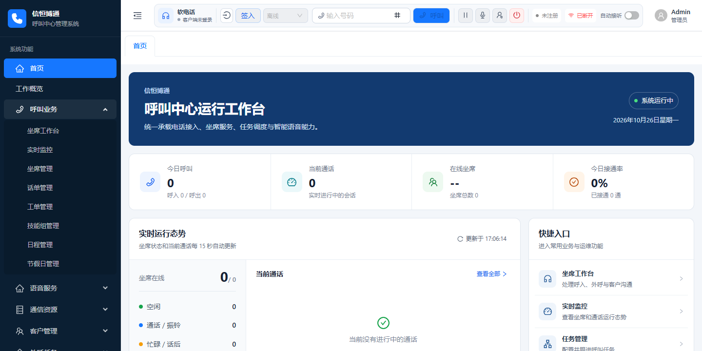

# 信恒博通呼叫中心

**把业务规则接进电话流程，把通话内容沉淀为业务数据。**

客户来电后，系统可以按哪些条件分流？能否查询业务数据再决定转接？通话内容怎样留下文字记录？企业要求在国产软硬件环境中部署，又该从哪里开始？

信恒博通呼叫中心基于 OpenCallHub 维护和扩展，围绕这些实际问题，重点补充了 **IVR 业务编排、通话转写、多引擎语音服务、工单处理与国产环境部署方案**。企业和集成团队可以在已有呼叫能力上接入自己的业务规则，逐步构建符合自身服务流程的应用。

本版本的价值，体现在新增能力如何落到具体业务中。

## 新增与增强概览

| 新增或增强的内容 | 解决的具体问题 | 可以开展的业务应用 |
| --- | --- | --- |
| **IVR 条件、赋值、数据库和简单脚本赋值节点** | 电话路由需要结合时间、客户类型和业务查询结果作判断 | 按工作时间分流、查询客户分类、选择接待技能组。 |
| **ASR 音频处理、实时文本推送与转写记录** | 通话中的信息需要人工整理，后续查阅依赖反复听录音 | 接入识别引擎后展示转写、保存最终文本、按通话查阅记录。 |
| **统一 ASR/TTS 接口与多引擎适配** | 不同语音服务接口各异，更换引擎需要重复接入 | 根据语言、音质、成本和部署要求选择云端或本地引擎。 |
| **工单接口及工作台联动** | 来电诉求需要从口头沟通转为可保存、可查询的业务事项 | 查询客户、登记工单、补充处理信息，为后续交接提供依据。 |
| **国产环境部署适配资料与打包脚本** | 指定国产 CPU、操作系统、数据库和中间件后，缺少对应部署路径 | 围绕海光、统信 UOS、人大金仓、东方通 TongWeb 组织部署评估。 |
| **MySQL 演示适配、容器编排和公开初始化材料** | 拿到源码后仍需自行整理依赖、建表、配置和启动方式 | 在独立环境运行演示，验证业务，再推进线路和语音服务联调。 |

以上为当前维护版本的扩展重点；具体实现与验证状态见文末说明。

*工作台界面，图中为演示数据。*

## 1. 扩展 IVR：让电话流程能够读取业务、执行判断

**新增了什么：** 在原有流程基础上，增加条件分支、变量赋值、数据库查询和简单脚本赋值四类节点，并补充流程变量、表达式及节点调度处理。

**解决什么问题：** 企业的接待规则往往取决于具体业务：是否在工作时间、客户属于哪一类、查询结果满足什么条件、应该转给哪个服务团队。这些规则需要在电话流程中表达和执行。

通过扩展节点，开发者可以把业务查询结果写入流程变量，再按条件进入不同分支。一个接待方案可以这样组织：

> 来电 → 判断服务时间 → 查询客户分类 → 按规则选择技能组 → 转入人工服务。

对企业而言，价值在于把接待规则沉淀为可维护的流程；对集成团队而言，已有节点可以复用，特殊业务可以继续扩展。上述流程为应用示例，需要结合实际数据源和通信环境配置验收。

## 2. 新增通话转写：让服务内容留下可查阅的文字

**新增了什么：** 补充音频格式处理、识别会话管理、临时与最终结果处理、实时文本推送，以及转写全文与分段记录的保存能力。

**解决什么问题：** 电话结束后，客户具体说了什么、有哪些细节，常常需要依靠坐席回忆或重新听录音。通话信息难以直接用于后续查阅和业务处理。

接入真实识别引擎后，可在工作台展示转写内容，将最终文本按通话关联保存。代码也处理了临时结果更新、最终结果替换和重复消息，帮助开发者管理持续变化的识别结果。

这为服务复核、交接和后续分析提供了文字资料，也为未来的关键词分析、摘要或质检开发准备输入数据。当前转写记录中的“摘要”指全文汇总，自动生成业务摘要与智能质检属于后续扩展方向。

## 3. 统一语音服务：让识别与播报可以按业务选择

**新增了什么：** 统一 ASR/TTS 服务接口，增加多引擎适配，以及 TTS 任务状态、音频文件、缓存和播放对接处理。

**解决什么问题：** 不同服务商的鉴权、音频要求和结果格式存在差异。如果业务直接依赖某个服务商，增加或替换引擎时，往往需要同时修改多处业务代码。

当前已包含腾讯云、阿里云的语音适配，以及 FunASR 识别、CosyVoice 合成等本地引擎方向的适配代码。业务层通过统一接口发起请求，便于逐项评估引擎效果和接入成本。

在欢迎语、服务提示和业务播报等场景中，可以通过文本生成音频，并管理合成任务与文件。需要减少外部服务依赖的企业，也有继续对接本地引擎的入口；实际效果与资源需求通过目标环境测试确定。

## 4. 补充工单与工作台：让来电诉求进入后续处理

**新增或增强了什么：** 工单创建、查询和修改接口，配套来电登记入口，以及工作台中的客户查询、通话信息和语音服务入口。

**解决什么问题：** 客户的问题即使已经在电话中说明，也需要被整理成可保存、可跟进的事项。依赖个人笔记或口头交接时，后续处理缺少统一记录。

坐席可以查询客户并登记工单，补充诉求、优先级和处理信息，再由团队依据已保存记录继续工作。结合原有客户、坐席和话单管理能力，企业能够围绕一次服务组织相关信息。

客服受理、售后登记、内部服务台和回访结果登记，都可以从这条基础业务路径开始验证。

## 5. 补充国产环境适配：让指定技术路线有部署依据

**新增了什么：** 面向国产软硬件环境的配置、WAR 打包脚本、安装说明与排障资料，覆盖以下目标组合：

| 层级 | 目标产品或平台 | 已准备的适配内容 |
| --- | --- | --- |
| 处理器 | 海光 C86，x86_64 架构 | 对应架构的软件包与依赖准备说明。 |
| 操作系统 | 统信 UOS Server V20 | 安装路径、环境变量、文件权限和运行依赖说明。 |
| 数据库 | 人大金仓 KingbaseES V8R6 | JDBC 接入、数据库方言适配及对应初始化材料。 |
| 应用中间件 | 东方通 TongWeb 8 | 前后端 WAR 打包、应用上下文、外部配置和独立实例部署说明。 |

**解决什么问题：** 国产化项目需要同时处理处理器架构、系统依赖、数据库差异和应用服务器兼容。已有部署资料把这些工作拆解为可检查的配置与步骤，供企业技术团队和集成商评估实施工作量。

这部分更适合有指定基础设施、内网部署或国产化选型要求的企业与机构。交付评估时，可以把应用运行、数据读写和通信接入分别验收，明确每一层的完成状态。

现有国产环境方案以**前端和 API 部署**为范围，目标机运行与电话链路需另行验收；相关资料不构成全栈信创认证或全部国产平台兼容承诺。对外可表述为“提供国产环境部署适配方案”。

## 6. 补齐演示交付：让技术评估有一个能运行的起点

**新增或补齐了什么：** MySQL 演示适配、独立空库初始化、合成演示数据、Docker Compose、FreeSWITCH 构建配置，以及复用现有 Nginx 的部署方式。

**解决什么问题：** 项目评估需要验证登录、业务数据保存、组件连接和重启后的状态。缺少初始化与部署材料时，技术团队需要先花时间整理环境，才能开始判断业务是否适用。

当前 MySQL 演示版已完成真实部署，验证了登录、权限菜单、客户和工单的部分核心操作、重启后数据保留，以及 FreeSWITCH 的后端认证连接和动态配置加载。

对于企业，这是开展业务试点的起点；对于开发者和集成商，这是评估源码、部署工作量及定制范围的参考。公开源码使用脱敏配置和合成数据，私有部署凭据单独管理。

## 推荐先展示这三个场景

**场景一：按业务规则接待。** 在 IVR 中组织时间判断、客户查询和技能组转接，展示新增业务节点如何表达企业的接待规则。先审阅流程配置，再结合真实线路验证执行结果。

**场景二：一通电话留下两类记录。** 围绕一次服务展示转写文本和工单：前者保存沟通内容，后者登记需要处理的事项。当前可分别验证模拟转写与工单操作，真实通话场景在引擎和线路接入后验收。

**场景三：在指定国产环境中交付。** 围绕 UOS、KingbaseES 和 TongWeb 的目标组合，展示部署材料、打包方式和配置路径，再与客户确定目标机安装、应用运行及通信联调的验收清单。

## 开源定位与当前范围

本版本面向需要**扩展电话业务、接入语音服务、实施私有化及国产环境部署**的企业技术团队和集成商。Java、Vue 与 FreeSWITCH 的模块化结构，为新增业务接口、流程节点和引擎适配提供开发基础。

截至 2026-10-28，后台业务、语音 Mock 处理链路、页面、FreeSWITCH 组件连接及 RustFS 存储接入已有验证记录。合成录音已完成上传、播放、下载及重启后读取验证；真实终端通话、双向音频、实际通话录音、远程浏览器话务、运营商线路及真实语音效果仍需联调，IVR 收号节点仍待完善。具体范围见[验收记录](../../deploy/demo/VALIDATION.md)。

文中“新增与增强”依据当前代码、迁移记录和固定上游参考的文件差异整理，不将原有坐席、客户、外呼等能力全部归为本版本原创。来源与修改范围见[来源记录](provenance.md)。

信恒博通呼叫中心基于 [OpenCallHub](https://github.com/sxwdmjy/openCallHub) 维护和扩展。后端遵循 [GNU GPLv3](../../LICENSE)，配套前端保留 Apache-2.0 许可证；公共依赖与第三方组件遵守各自许可。商业使用、修改和分发应履行适用许可证的义务。

了解更多：[开源文档](README.md) · [部署说明](../../deploy/demo/DOCKER.md) · [依赖说明](dependencies.md) · [来源与修改记录](provenance.md) · [许可证说明](../../NOTICE.md)。

*文档更新：2026-10-28。*
